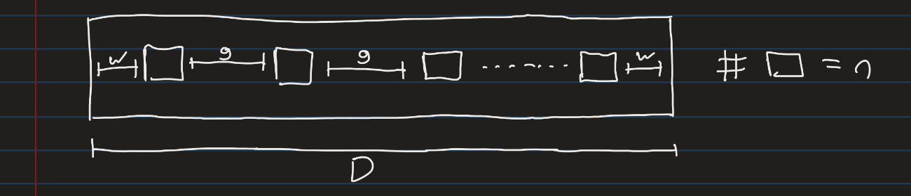
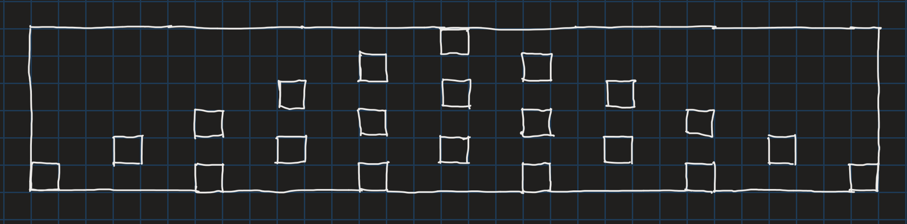
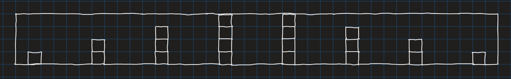

## The Problem:

A ceiling is made up of discrete blocks and populated with lights (that each take up a full block) at regular intervals. The lights must be placed such that the first light and the last light are the same distance to the first wall and the last wall respectively, and then every light in between is placed at regular intervals.

Given a certain dimension $D$ and gap $g$, we need to find a distance from the wall $w$ and number of lights $n$ that will ensure the ceiling lines up.

For example, a 31 block wide ceiling with a gap of 5 empty spaces between each light would work with a margin of 3 at each wall because:
$$
3+1+5+1+5+1+5+1+5+1+3=31
$$

## The Equation:

Any valid configuration of lights must satisfy the equation:
$$
D = 2w + n +(n-1)g
$$
This is simply because the total number of lights $n$ plus the space taken by the $(n-1)$ gaps between them plus the two margins at each end $2w$ must equal the length of the ceiling for it all to line up.

### Conditions for a valid configuration:

#### First condition:
Since $w$ must be a whole number, we can rearrange the equation to get a parity condition:

$$
w = \frac{D-n-(n-1)g}{2}
$$
So:
$$
D-n-(n-1)g \equiv 0 \pmod{2}
$$
Rearranged:
$$
\boxed{D+g-n(g+1) \equiv 0 \pmod{2}}
$$

#### Second condition:
The gap between the wall and the first light must be non-negative, so $w \ge 0$ . This gives an upper bound on the number of lights $n$:

$$
\begin{gathered}
\frac{D+g-n(g+1)}{2} \ge 0 \\[6pt]
D+g-n(g+1) \ge 0 \\[6pt]
D+g \ge n(g+1) \\[6pt]
\boxed{n \le \left\lfloor\frac{D+g}{g+1}\right\rfloor}
\end{gathered}
$$

$g \ge 0$ is assumed so dividing by $g+1$ keeps the direction of the inequality sign the same.

#### Third condition:
There must be at least one light:
$$
n \ge 1
$$

## Parity Analysis

The first condition requires the numerator $D + g - n(g+1)$ to be even. Whether the number of lights $n$ affects this depends entirely on the parity of the **period** $g + 1$ (one light plus the gap after it). This splits the problem into two cases.

### Case 1: $g$ is odd

If $g$ is odd, then $g + 1$ is even, so $g + 1 \equiv 0 \pmod{2}$. For any $n$:

$$
n(g+1) \equiv n \cdot 0 \equiv 0 \pmod{2}
$$

So the term containing $n$ drops out of the condition entirely:

$$
D + g - n(g+1) \equiv D + g \pmod{2}
$$

The numerator is even exactly when $D + g$ is even. Since $g$ is odd, this means **$D$ must be odd**.

The important consequence is that $n$ plays no part in the parity condition. Each extra light subtracts another $g + 1$, which is even, and subtracting an even number never changes parity. So for a given $D$ and $g$, **either every $n$ allowed by the bound works, or none does.**

**Example: $D = 31$, $g = 5$.** Here $D$ is odd, so every $n$ from $1$ to $\left\lfloor \frac{36}{6} \right\rfloor = 6$ is valid:

$$
w = \frac{36 - 6n}{2} = 18 - 3n
$$

| $n$ | 1 | 2 | 3 | 4 | 5 | 6 |
|-----|---|---|---|---|---|---|
| $w$ | 15 | 12 | 9 | 6 | 3 | 0 |

**Example: $D = 38$, $g = 5$.** Here $D$ is even, so the numerator $43 - 6n$ is odd for every $n$ (37, 31, 25, ...). No symmetric configuration exists, however many lights are used.

### Case 2: $g$ is even

If $g$ is even, then $g + 1$ is odd, so $g + 1 \equiv 1 \pmod{2}$ and:

$$
n(g+1) \equiv n \pmod{2}
$$

This time $n$ does not drop out. The condition becomes:

$$
D + g - n \equiv 0 \pmod{2} \quad\Longrightarrow\quad n \equiv D + g \pmod{2}
$$

Since $g$ is even, adding it doesn't change parity, so $D + g \equiv D$, giving:

$$
\boxed{n \equiv D \pmod{2}}
$$

**The number of lights must have the same parity as the dimension.** Instead of all-or-nothing, exactly every other value of $n$ works.

**Example: $D = 38$, $g = 4$.** The bound gives $n \le \left\lfloor \frac{42}{5} \right\rfloor = 8$, and $D$ is even, so $n$ must be even:

$$
w = \frac{42 - 5n}{2}
$$

| $n$ | 2 | 4 | 6 | 8 |
|-----|---|---|---|---|
| $w$ | 16 | 11 | 6 | 1 |

Checking $n = 8$ directly: $1 + 8 + (7 \times 4) + 1 = 38$. An odd $n$ such as $n = 3$ gives a numerator of $42 - 15 = 27$, which is odd, so $w$ would not be a whole number.

#### When does a solution exist?

In Case 1, parity alone can rule out a dimension completely. In Case 2 it never does on its own, because there is always a parity of $n$ that matches $D$. A solution can still fail to exist if the bound is too small to allow any $n$ of that parity:

- **$D$ odd:** $n = 1$ has the right parity, and the bound allows it whenever $D \ge 1$. A solution always exists.
- **$D$ even:** the smallest allowed $n$ is $2$, which the bound permits only when $2(g+1) \le D + g$, that is, when $D \ge g + 2$.

This makes sense physically: two lights with a gap between them need at least $2 + g$ blocks. For example, $D = 2$, $g = 2$ has no solution. One light leaves $w = \frac{1}{2}$, and two lights need $4$ blocks.

### Why the steps are $\frac{g+1}{2}$ and $g+1$

Rewriting the formula for $w$ makes the pattern in both tables clear:

$$
w = \frac{D+g}{2} - n \cdot \frac{g+1}{2}
$$

$w$ decreases linearly with $n$, so each extra light reduces the wall margin by $\frac{g+1}{2}$. Removing a light frees up one light-plus-gap unit of $g + 1$ blocks, and symmetry requires that space to be **split equally between the two walls**.

- **$g$ odd:** $g + 1$ is even, so it splits evenly and each wall gains $\frac{g+1}{2}$ blocks. In the $g = 5$ example, each light removed adds $3$ to $w$.
- **$g$ even:** $g + 1$ is odd, so one freed unit can't be split equally. Lights must be removed **two at a time**, freeing $2(g+1)$ blocks, which gives each wall $g + 1$ more. In the $g = 4$ example, $n$ steps by $2$ and $w$ changes by $5$.

The parity condition and the step pattern are the same fact seen two ways: the number of lights can only change by amounts whose freed space divides evenly between the two walls.

### Summary

| | $g$ odd | $g$ even |
|---|---|---|
| Parity condition | $D$ odd | $n \equiv D \pmod{2}$ |
| Valid $n$ (within bounds) | All of them, or none | Every other value |
| Step between solutions | $n$ by $1$, $w$ by $\frac{g+1}{2}$ | $n$ by $2$, $w$ by $g+1$ |
| Can a solution fail to exist? | Yes, whenever $D$ is even | Only if $D$ is even and $D < g + 2$ |